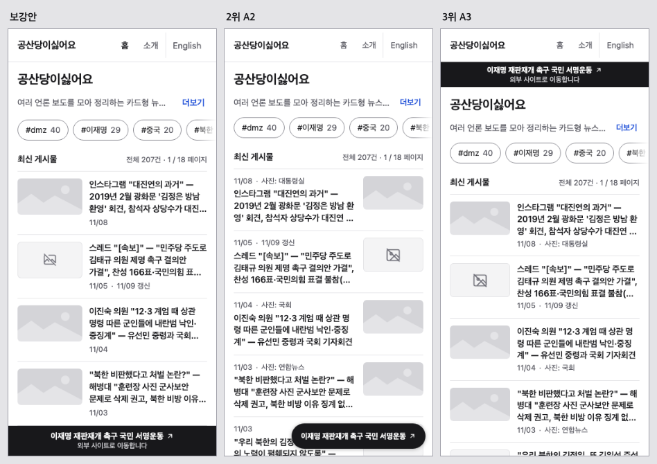
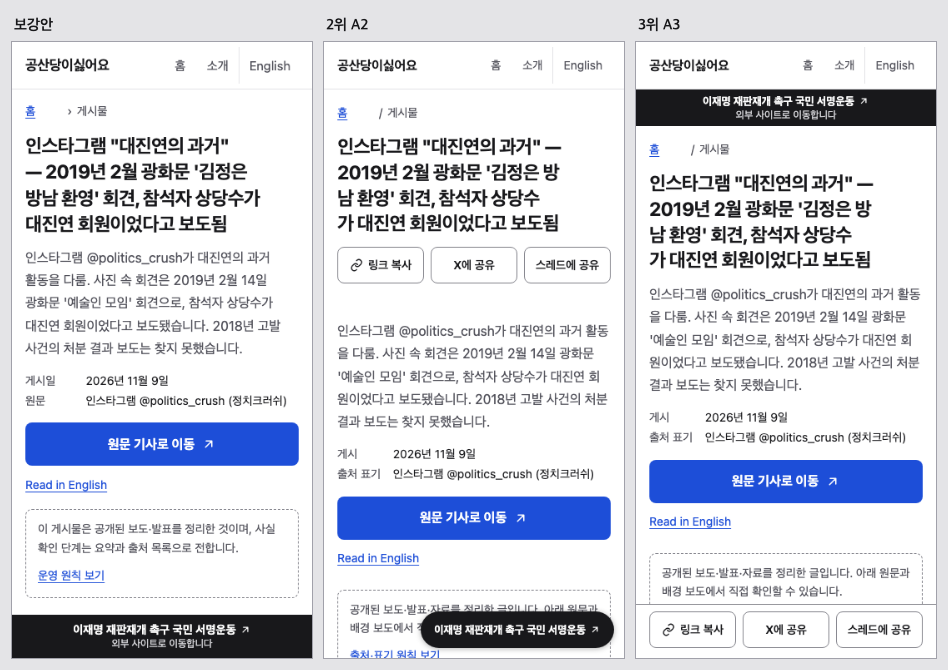
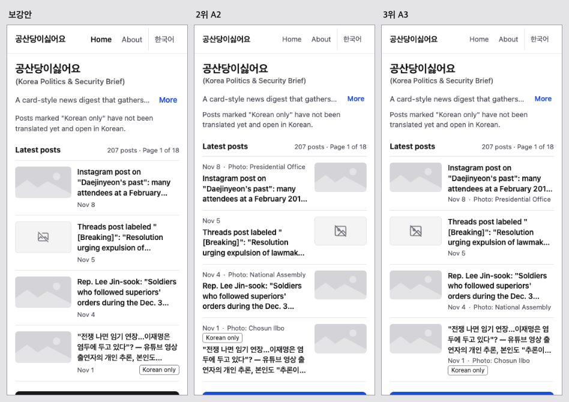
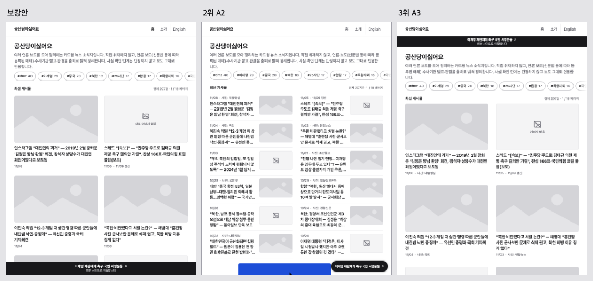
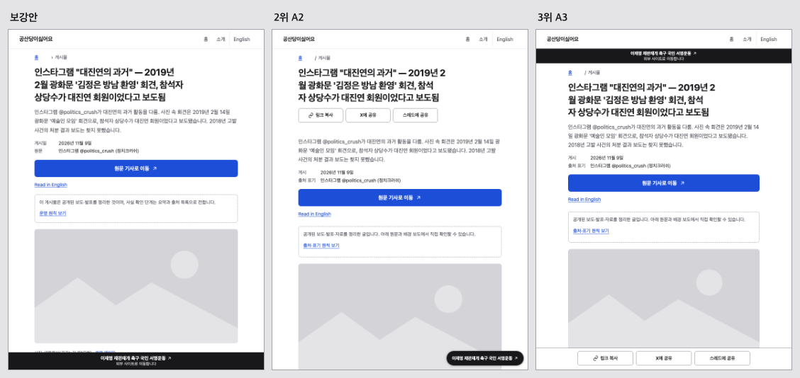
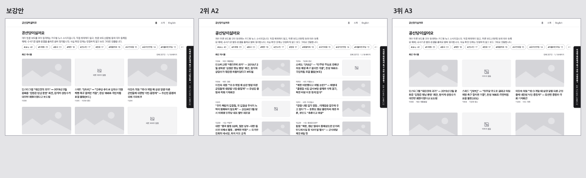
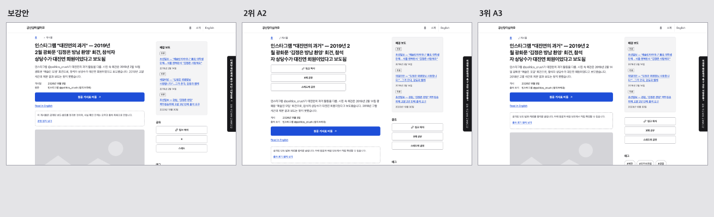

# 시안 비교 — 보강안 vs 2위 A2 vs 3위 A3

> 디자인 팀장 (Opus 5.5) · 2026-11-09. 휴대폰으로 보기 좋게 360 화면을 먼저 둔다. 각 그림은 왼쪽부터 보강안 · A2 · A3, 같은 폭으로 찍었다.
> 사진 자리는 모두 회색 자리표시다(실제 사진이 들어갈 곳). 점수·근거는 `02-scoring.md`, 보강안 설명은 `final/notes.md`.

## 순위

| 순위 | 시안 | 점수 |
|---|---|---|
| 1 → 보강안 | A1 + A3의 태블릿 그리드 + B1의 쪽 번호 | A1 92점 |
| 2 | A2 | 87.5점 |
| 3 | A3 | 83.5점 |
| 탈락 | B2 | 현재 쪽 번호 글자가 안 보임(흰 바탕 흰 글자) |

## 1. 휴대폰 홈 (360)

- 보강안: 카드 4장이 배너 위에 다 보인다. 배너는 맨 아래 띠로, 카드를 가리지 않는다.
- A2: 카드 모양은 같고 썸네일이 오른쪽이다. 배너가 오른쪽 아래 작은 알약이라 다섯째 카드 글자를 덮는다.
- A3: 배너가 헤더 바로 아래에 있어 카드가 44px 아래로 밀린다. 아래로 내리면 배너가 숨는다(사용자 확인 필요).

## 2. 휴대폰 상세 (360)

- 보강안: 제목·요약 다음에 "원문 기사로 이동" 버튼이 첫 화면에 보인다. 공유는 본문 뒤에 있다.
- A2: 제목 바로 아래에 공유 버튼 3개가 한 번 더 있어 원문 이동 버튼이 조금 내려간다.
- A3: 화면 아래에 공유 막대가 늘 붙어 있다. 위 배너까지 합치면 읽는 동안 165px가 고정이다.

## 3. 휴대폰 영어 피드 (360)

- 셋 다 헤더 한 줄(57px)이고 영어 부제는 제목 아래 둘째 줄이다.
- 보강안은 카드에 사진 출처를 쓰지 않고 상세 사진 아래에만 쓴다(사진 정책).
- A2·A3는 카드 날짜 줄에 "Photo: …"를 쓴다.

## 4. 태블릿 세로 (768)

- 보강안: 사진이 위, 제목이 아래인 카드 2열. 사진이 크게 보인다.
- A2: 작은 썸네일 목록 2열. 한 화면에 많이 보이지만 사진이 작다.
- A3: 보강안과 같은 2열(보강안이 이 방식을 가져왔다). 배너가 위에 있다.

- 셋 다 본문을 가운데 한 단(612px 안팎)으로 둔다.
- 보강안·A3는 본문 17px·16px, A2는 18px로 가장 크다.
- A3는 태블릿에서도 아래 공유 막대가 있다.

## 5. 컴퓨터 (1280)

- 보강안: 사진 카드 3열(카드 336px). 배너는 지금처럼 오른쪽 세로 탭.
- A2: 썸네일 목록 2열. 글은 많이 보이지만 사진이 192px로 작다.
- A3: 보강안과 같은 3열이다.

- 셋 다 본문 + 오른쪽 보조 열(배경 보도·공유·태그)이다.
- 보강안은 사진 아래에 "사진: 기관(공공누리 제1유형) · 원문 페이지"를 쓴다.
- A2는 제목 아래 공유 버튼이 한 번 더 있다.

## 6. 보강안에서 더 본 화면

태그 페이지·소개·이미지 상태 모음(사진 없음·깨짐 대체 카드)은 `final/` 안 `tag-360.png`·`about-360.png`·`states-360.png`(768·1024·1280도 있음).

## 7. 결정해 주실 것 (자세한 장단점은 `final/notes.md` §4)

| # | 질문 | 권장 |
|---|---|---|
| D1 | 휴대폰 배너 모양 | 1 하단 띠(부제 보임, 숨김 없음) |
| D2 | 피드 아래 버튼 | 1 "다음 페이지" + 쪽 번호 |
| D3 | 영어 사이트명 | 1 작은 화면은 헤더에 한국어 이름만, 부제는 제목 아래 |
| D4 | 카드에 사진 출처 글자 | 1 카드엔 이미지만, 출처는 상세 사진 아래 |
| D5 | 상세 끝 "같은 주제 글·이전/다음 글" | 2 이번 뒤 별도 작은 작업 |
| D6 | 영어 월별 목록(새 주소) | 1 보류 |
| D7 | "링크" 표기 | 1 카드·상세 모두 제거 |
